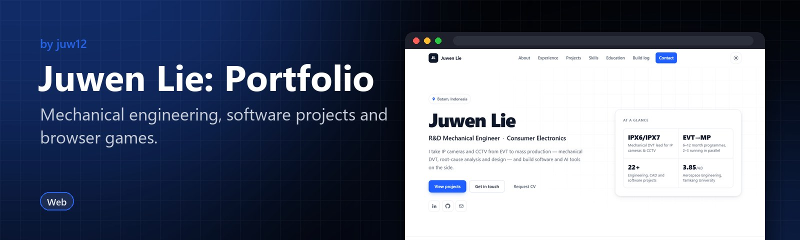
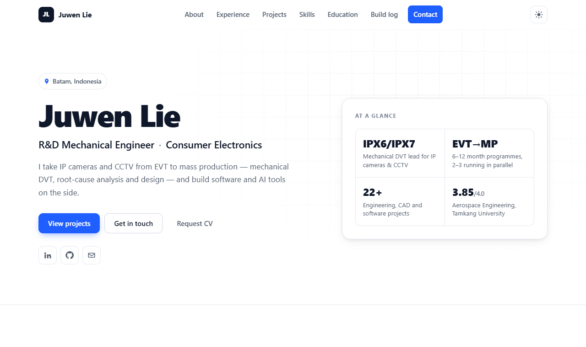

<!-- HERO:START -->
<p align="center">
  <a href="https://juw12.github.io/portfolio/"></a>
</p>

<p align="center">
  <b>Mechanical engineering, software projects and browser games.</b><br>
  An interactive portfolio, plus Townsquare 3D and Cozy Island, playable in the browser.
</p>

<p align="center">
  <a href="https://juw12.github.io/portfolio/"><b>Try it live</b></a> ·
  <a href="#see-it-in-action">See it in action</a> ·
  <a href="#highlights">Highlights</a> ·
  <a href="https://github.com/juw12">More by juw12</a>
</p>

<p align="center">
  <a href="https://github.com/juw12/portfolio"></a>
  <a href="https://juw12.github.io/portfolio/"></a>
  
</p>

<a id="highlights"></a>
<table>
  <tr>
    <td width="33%" valign="top">
      <b>R&D engineering</b><br>
      Product reliability, DVT, NPI and root-cause analysis work.
    </td>
    <td width="33%" valign="top">
      <b>Townsquare 3D</b><br>
      A shared 3D town: claim land, run crops and trade at a live market.
    </td>
    <td width="33%" valign="top">
      <b>Cozy Island</b><br>
      A cozy 3D island for laptop workers, in a single HTML file.
    </td>
  </tr>
</table>

## See it in action

<p align="center">
  <a href="https://juw12.github.io/portfolio/"></a><br>
  <sub>Open the interactive demo at <a href="https://juw12.github.io/portfolio/">juw12.github.io/portfolio/</a></sub>
</p>
<!-- HERO:END -->

## About

Interactive personal portfolio for **Juwen Lie** — R&D Mechanical Engineer (Mechanical · Aerospace · AI · Tech · Systems).

A single-page, **zero-dependency** static site with a clean, professional layout: system fonts, light/dark themes (follows the OS setting, remembers your choice), filterable and searchable project cards, and a details dialog per project.

**Live:** https://juwenlie.pages.dev/ (Cloudflare Pages, auto-deploys from `main`). The old https://juw12.github.io/portfolio/ address still serves the same site (canonical URL points to pages.dev).

## Local preview

Open `index.html` directly in a browser, or serve the folder:

```
python -m http.server 8000
```

Then visit http://localhost:8000/. The site works fully offline (`file://`) — no build step and no external requests.

## Structure

| Path | Purpose |
|---|---|
| `index.html` | The page (hero, about, experience, projects, skills, education, contact, connect) |
| `styles.css` | Theme + layout |
| `app.js` | Theme toggle, active-section nav, reveal on scroll, project filters + search, project details dialog, copy email |
| `assets/projects/` | Project card art: 1600x1000 live-UI screenshots in the standard browser frame on the dark accent gradient. Make cards with `python scripts/portfolio_card.py <id>` in the projects repo; `.github/workflows/check-cards.yml` flags off-style art |
| `assets/qr/` | Contact QR codes (LinkedIn, GitHub, email, bio.site) |
| `obsidian/` | Portfolio Obsidian vault: every project note as Markdown plus a one-file zip bundle — see [`obsidian/README.md`](obsidian/README.md) |
| `.github/workflows/pages.yml` | Deploys to GitHub Pages on push to `main` (kept so old links keep working) |

## AI Daily (`/news/`)

A public daily AI briefing, built every morning at 06:00 WIB by `.github/workflows/ai-daily.yml`:
`scripts/ai_daily/build_ai_daily.py build` collects AI feeds, clusters duplicate stories across
outlets, writes "The Brief" with Qwen3 8B running in Ollama inside the free Actions runner (no API key; GitHub Models was retired in July 2026), and publishes
`news/index.html`, `news/YYYY-MM-DD.html`, `news/archive.json` and `news/feed.xml`.
`... send` then emails each subscriber a personal copy from Gmail (own unsubscribe link, welcome banner on the first issue; once per day, `news/sent.json`). Signups and unsubscribes from the site go through FormSubmit to that Gmail inbox, which is the subscriber list; nothing personal is stored in this repo or printed in logs.

- Feeds, sections and topic filter: `scripts/ai_daily/config_ai_daily.json`.
- Email delivery needs two things: the signup inbox in `assets/subscribe.js` (`inbox`, also turns on the AI Daily
  checkbox in the /hi/ and /log/ forms and the form on /news/) and the `GMAIL_APP_PASSWORD` repository secret
  (optional `GMAIL_ADDRESS`, default juwpegatron@gmail.com). Free Gmail sends ~500 emails/day; the sender caps at 450.
- Unsubscribe: `news/unsubscribe.html` (linked in every email), Gmail's unsubscribe button, or replying "unsubscribe".
- Run it by hand: Actions → AI Daily → Run workflow → mode `check` (count signups, send nothing), `test` (email only your own inbox), `publish` (rebuild + publish, no email) or `publish+send`.
- Signups: the forms post to a free Google Apps Script web app (`scripts/ai_daily/signups-apps-script.gs`, deployed from the inbox's Google account; its URL goes in `endpoint` in `assets/subscribe.js`) that drops an "AI Daily: subscribe" email into the inbox. The build log joins Substack in the same press (background request to Substack's own signup endpoint).

## Project cards

Most cards are generated from `scripts/apps.json` in [juw12/projects](https://github.com/juw12/projects) by `scripts/publish_portfolio.py` (hourly via `.github/workflows/sync-cards.yml`). Each app has a one-line `summary` (the card text, kept under ~120 characters so every card is the same size) and a full `description` (shown when the card is clicked). Edit the catalog, not the generated block in `index.html`. To hide an app, set `"portfolio": false` on its catalog entry (no card) and/or `"feed": false` (left out of `feed.xml` and the `/log/` build log).

New repos are not added automatically: every hourly run, `scripts/check_missing_repos.py` compares the public repos on github.com/juw12 with the catalog and keeps one issue, **Public repos without a portfolio card**, up to date (it closes itself when the list is empty). Add the repo to `apps.json` to give it a card, or list it in `repo-ignore.json` to skip it for good.

## CV & documents

CVs and employer-specific information are shared privately on request.

## Notes

- No frameworks, no build tooling, no external fonts or CDNs.
- Hosted on Cloudflare Pages (no build step, output directory `/`); GitHub Pages kept as a mirror so old links keep working.

## Ownership

Maintained by [@juw12](https://github.com/juw12).
Original commit authorship is preserved.

## License

Released under the [MIT License](LICENSE) © 2026 Juwen Lie. Contributions are welcome under the same license; see the [contributing guide](https://github.com/juw12/.github/blob/main/CONTRIBUTING.md) and [Code of Conduct](https://github.com/juw12/.github/blob/main/CODE_OF_CONDUCT.md).
