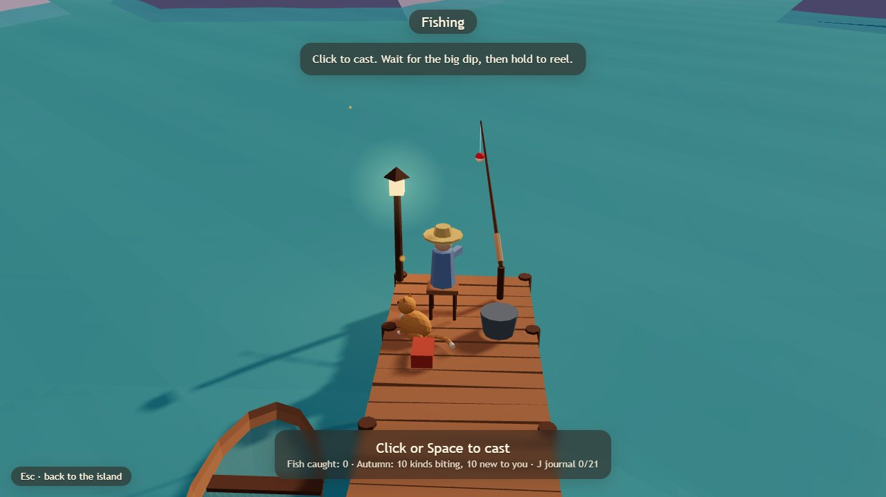
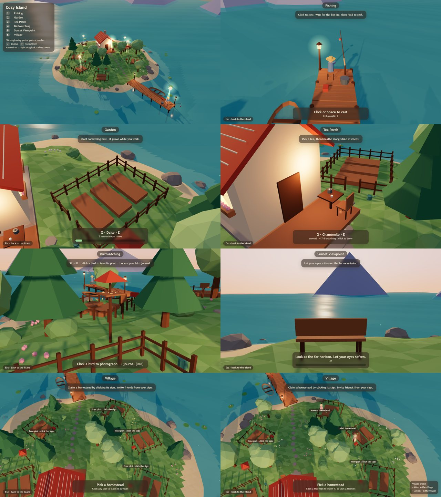
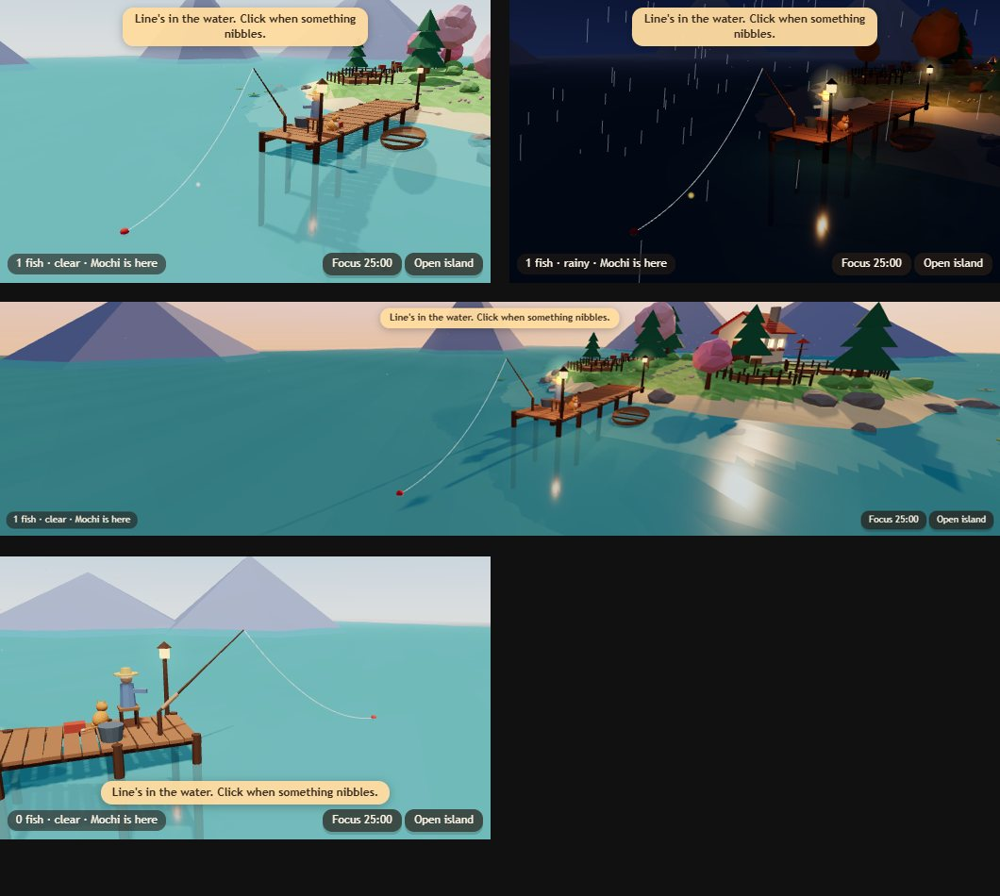
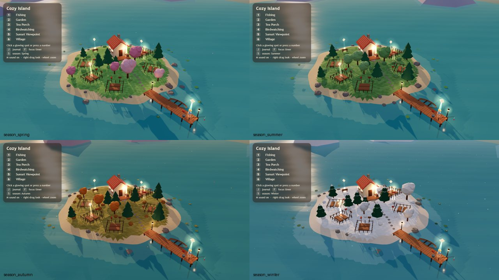
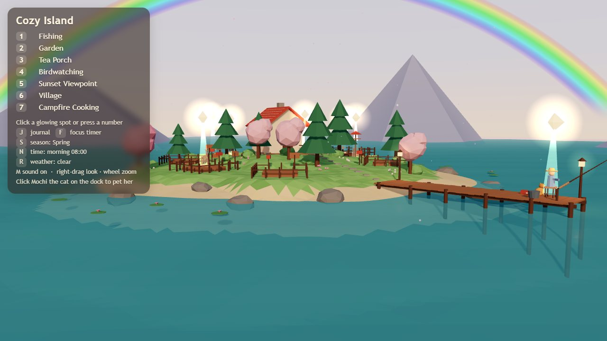
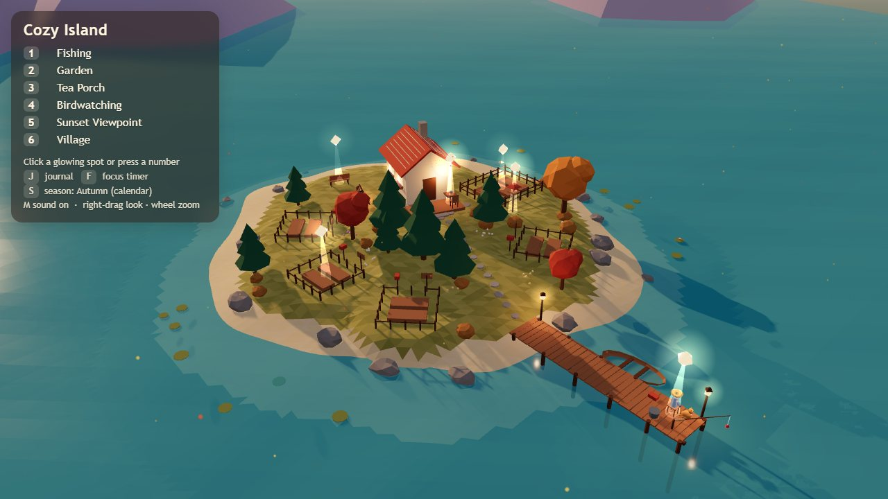
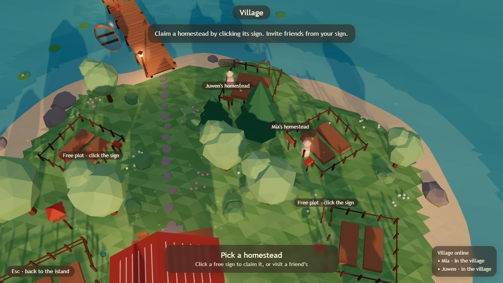
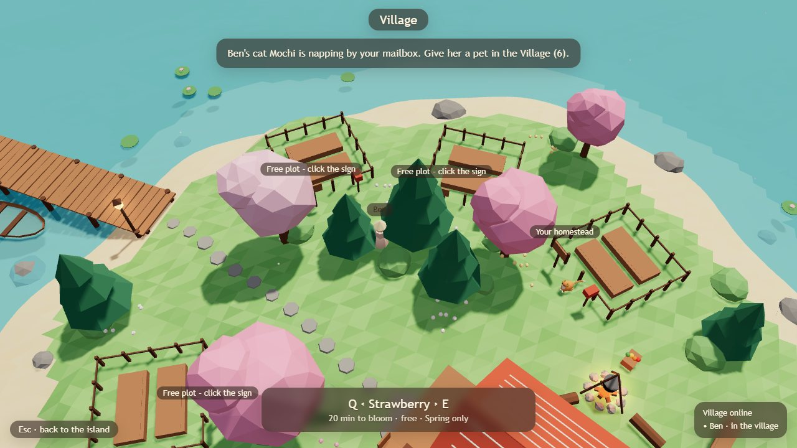

# Games

| Game | Play | What it is |
| --- | --- | --- |
| **Cozy Island** | [Play](https://juwenlie.pages.dev/game/) | A cozy 3D island for laptop workers: fishing, garden, tea breaks and a Desk mode. [Details below](#cozy-island) |
| **Townsquare 3D** | [Play](https://juw12.github.io/portfolio/game/townsquare/) | A shared 3D town: claim land, run producers, trade at the market, build, and meet the townsfolk. [Details](townsquare/README.md) |

---

# Cozy Island

A small, cozy 3D island for laptop workers: fish off the dock, tend a garden, breathe with a cup of tea,
watch birds, rest your eyes at the sunset viewpoint — and keep a tiny island beside your work in **Desk mode**.
Soft ASMR-style sounds, seasons, day & night, rain and rainbows, and Mochi the cat.

**▶ Play in the browser:** [juwenlie.pages.dev/game/](https://juwenlie.pages.dev/game/)
(single HTML file, three.js, no install; progress is saved in your browser)

**Look and feel:** a calm, professional interface on warm paper-light panels with one terracotta accent, one set of line icons and no emoji. On phones the island stays visible: a slim activity strip on top and a short bottom sheet (one row each for places and tools in landscape). Spec: [source/design.md](source/design.md).

## What you can do

| Activity | What it is |
| --- | --- |
| Fishing | Cast, wait for the real bite (nibbles are fake-outs), reel gently. Fish journal with seasonal and night catches. |
| Garden | Plant, water and harvest; plants keep growing in real time while you work. |
| Tea breathing | A guided breathing break with a steaming cup. |
| Birdwatching | 12 seasonal species plus a night owl, logged in your journal. |
| Sunset viewpoint | Eye-rest and short stretch prompts. |
| Campfire cooking | Cook what you caught and grew. |
| Village | Claim a homestead, invite friends, water each other's plants, leave notes and gifts *(needs the village server, see below)*. |

Plus: four seasons, day/night, soft rain (with rainbows after daytime showers), Mochi the cat (pet her; with the
village server she can visit friends and bring back souvenirs), a mailbox for gifts and a 25-minute focus timer.

## Desk mode (D)

Press **D** and the island shrinks into a little window you can park beside your spreadsheet or code.
In Chrome/Edge it opens as an **always-on-top floating window** (Document Picture-in-Picture); other browsers keep a compact
view in the tab. A fish nibbles every 45–120 s — click within 12 s to land it. Focus-timer button, toasts and Mochi still work,
and it runs in low-power mode (~20 fps, 1× resolution, slow shadow refresh).

## Controls

| Key / mouse | Action |
| --- | --- |
| Click a glowing spot, its button, or press **1–7** | Start an activity |
| **← Island** button (left rail) or **Esc** | Back to the island |
| Activity buttons in the left rail | Switch straight to another activity |
| Right-drag · wheel | Look around · zoom |
| **Q / E** | Previous / next seed, tea or recipe |
| **J** | Journal (fish, birds) |
| **F** | 25-minute focus timer |
| **D** | Desk mode |
| **S / N / R** | Cycle season / time of day / weather |
| **M** | Sound on/off |

**On a phone or tablet** (iPhone Safari, Android Chrome): tap a glowing spot or an activity button, drag with one
finger to look around the island and pinch to zoom. The island menu folds away while you drag (or tap **hide**) and
comes back when you return. Inside an activity, a labelled strip along the top (left rail when the phone is sideways)
goes back to the island or switches straight to another activity, and a **← Island** button sits by your thumb at the
bottom. The on-screen ‹ › and buttons replace Q/E and J, and the tool row (Journal, Focus, season, time, weather,
Sound) replaces J/F/S/N/R/M.

## Seasons, weather and friends

| | |
| --- | --- |
|  |  |
|  |  |

## Playing together (village server)

The hosted page runs in **offline mode** (static hosting has no backend). To share a village with friends:

1. Download [`source/`](source/) and double-click `StartVillageServer.bat` (Python 3, standard library only).
 It builds the game and serves it at `http://localhost:8787`.
2. Claim a homestead sign, click it and **Copy invite link**; friends on the same Wi-Fi join with the link or 6-letter code.
3. Over the internet: run a tunnel (e.g. `cloudflared tunnel --url http://localhost:8787`) and set `PUBLIC_URL`.

It's meant for friends you trust — there's no account system, rate limiting or moderation.

## How it's built

- **Browser game:** plain JavaScript + [three.js](https://threejs.org/) (`source/app/src/*.js`), low-poly geometry and
 sounds generated in code (Web Audio), bundled into one HTML file by `source/app/build.py`.
- **Village server:** `source/server/village_server.py` — a small JSON API (plots, invites, presence, gifts, cat visits)
 with server-time plant growth and owner/plot-mate/visitor rules.
- **Starter kit for a Unity version:** Blender island generator (`source/blender/cozy_fishing_scene.py`),
 Unity C# scripts (`source/unity/`) and a Unity Cloud Code module (`source/cloudcode/`).
- Headless Chrome render and UI test scripts live in `source/app/` and `source/app/test/`.

Full design notes and setup guide: [`source/README.md`](source/README.md).
