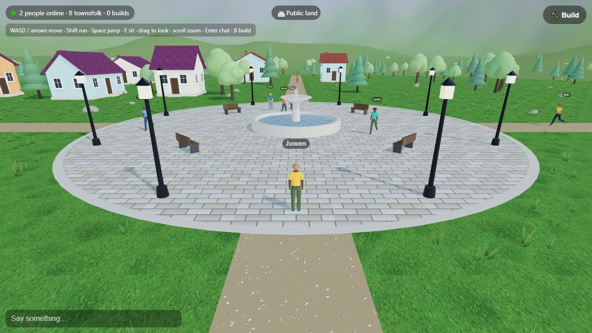
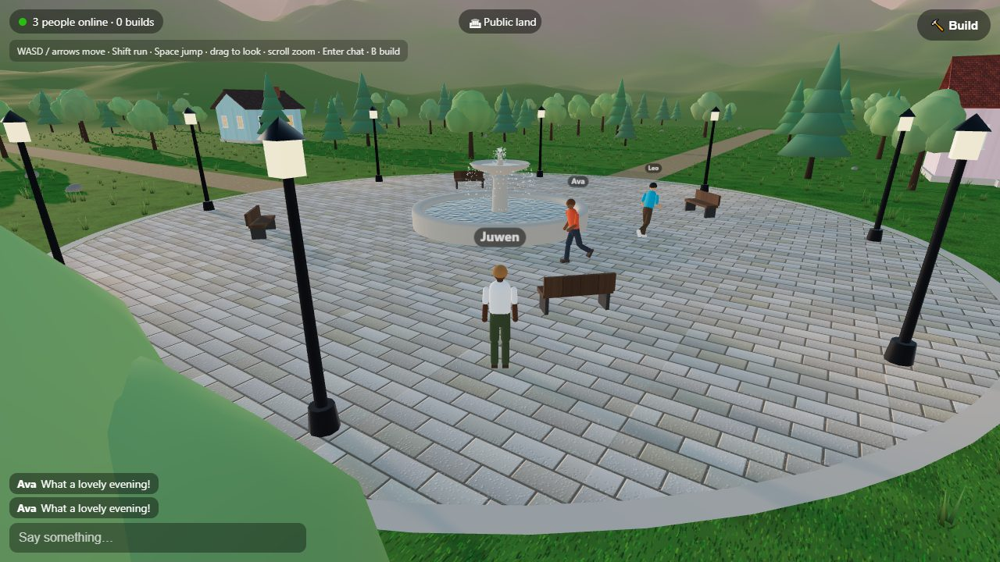
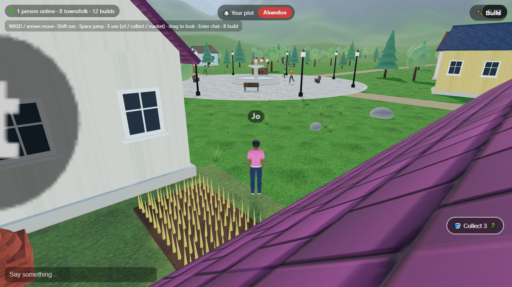
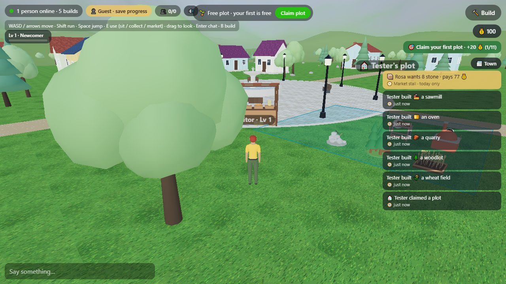
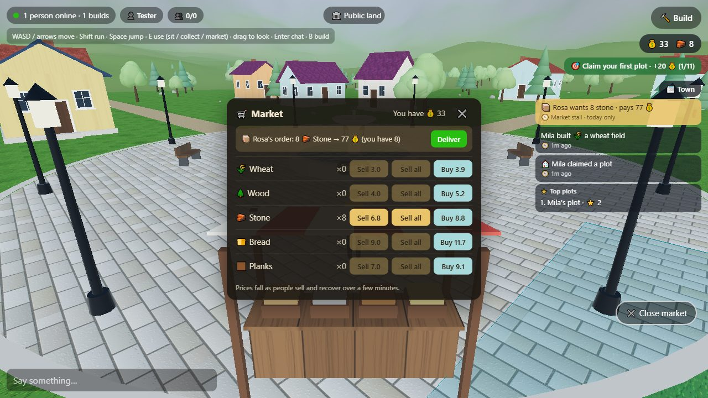
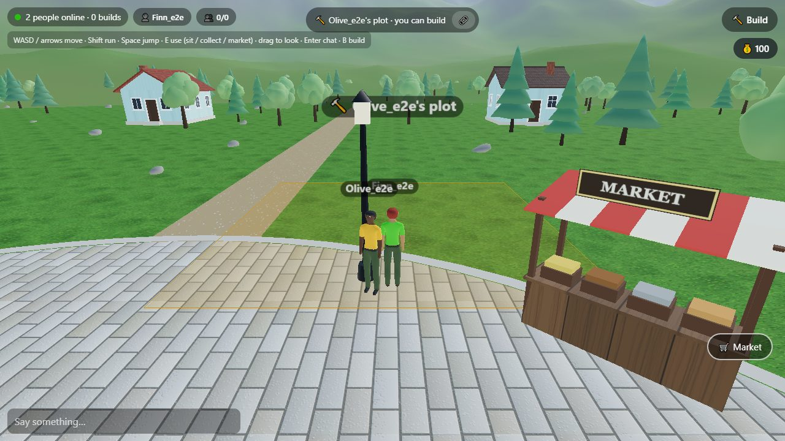
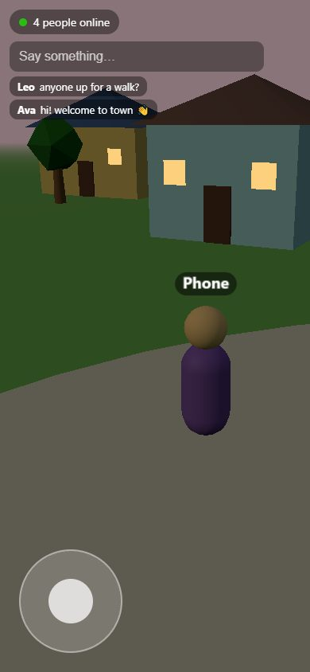
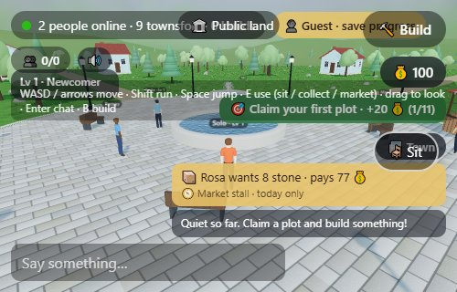

# Townsquare 3D 🏘️

A shared 3D town for phone and desktop browsers: walk around, claim land, grow and make goods,
trade at the market, build, and watch the town come alive with nine townsfolk who keep their own routines.

**▶ Play in the browser:** [juw12.github.io/portfolio/game/townsquare/](https://juw12.github.io/portfolio/game/townsquare/)
· [juwenlie.pages.dev/game/townsquare/](https://juwenlie.pages.dev/game/townsquare/)
(no install; works on phones; progress is saved in your browser)

## What you can do

| | |
| --- | --- |
| 🏡 **Land** | Claim 10 × 10 m plots (the first one is free) and build with blocks, walls, glass, lamps, trees, flowers and benches. |
| 🌾 **Production** | Wheat fields, woodlots, quarries, ovens and sawmills make goods over time; collect them when they're ready. |
| 🛒 **Market** | Sell and buy at Rosa's stall. Prices move with supply and demand, and Rosa posts a daily order for a bonus. |
| 🎯 **Progress** | A goal chain from your first plot to 1,000 coins, plus XP, levels and titles, a town feed and small celebrations. |
| 🧑‍🤝‍🧑 **Townsfolk** | Nine residents with homes, daily routines and chatter, driven by the town clock and a day/night sky. |
| 👥 **Social** *(multiplayer server)* | Friends, `/visit`, share links, ⭐ stars on plots, top plots, co-builders, chat with a word filter, mute and report. |

Designed to be gripping without dark patterns: no paid randomness, no streaks, no fake urgency.

| | |
| --- | --- |
|  |  |
|  |  |
|  |  |

## Controls

| Desktop | Phone | Action |
| --- | --- | --- |
| **WASD** / arrows · **Shift** | Left joystick | Walk · run |
| **Space** | JUMP button | Jump |
| Drag | Drag | Look around |
| **E** | Tap | Sit, collect goods, open the market |
| **B** | Build button | Build mode |
| **Enter** | Chat box | Chat (`/help` lists commands) |

## Solo mode on this page

GitHub Pages only serves static files, so this copy runs in **solo mode**: the game's *real* Python
server logic (economy, land, goals, townsfolk, safety rules) is loaded into your browser with
[Pyodide](https://pyodide.org/) (Python compiled to WebAssembly), and the game's `api/*` requests are
answered inside the page. Your town is saved in the browser (IndexedDB). The first visit downloads
about 10 MB for the Python runtime and then starts in a few seconds.

Multiplayer (other people, friends, moderation) needs the Python server, which runs the same code
over HTTP with HTTPS hosting through Caddy or Docker Compose.

## How it's built

- **Client:** plain JavaScript ES modules + [three.js](https://threejs.org/); builds are drawn as instanced
  batches (about 3× fewer draw calls in a busy town); phones get far-away players less often.
- **Server:** one Python file using only the standard library (`engine/server.py`), with the economy,
  goals, orders, progress, townsfolk, accounts (PBKDF2) and moderation in separate modules.
  137 unit tests cover it.
- **Assets:** the rigged, animated character and the market stall and producer models are generated
  by Blender scripts, exported as glTF (`models/`).
- **Static build:** `build_web.py` copies the client, adds `solo.js` and puts the server modules in
  `engine/`; every path is relative, so the same files run at any URL.
